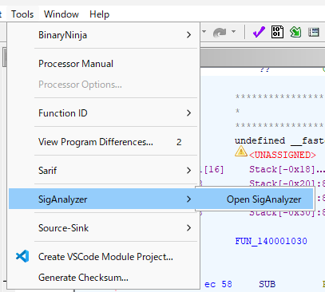
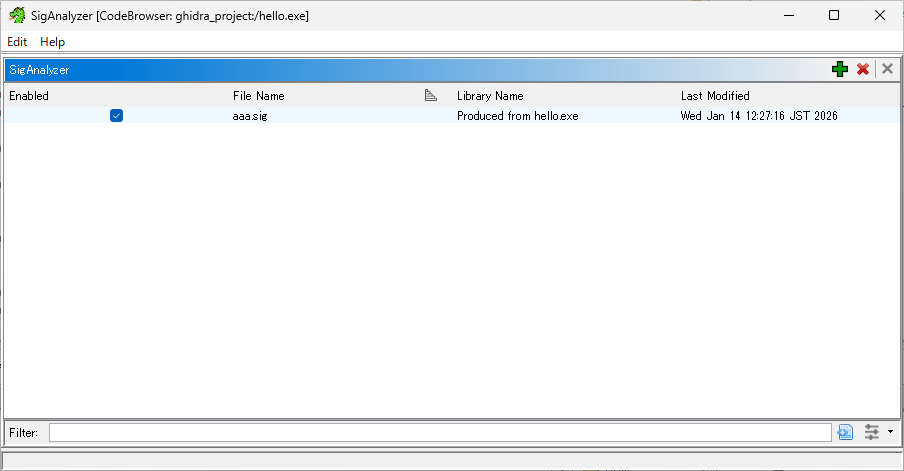

[日本語版README](README_ja.md)
# SigAnalyzer
A Ghidra plugin that applies IDA's FLIRT signatures to Ghidra.

SigAnalyzer is added to the Analyzer.

A menu is added under **Tools** where you can add/remove signatures and choose which files to exclude from the Analyzer.

## Usage

### Adding FLIRT Signatures

Select **Tools → SigAnalyzer → Open SigAnalyzer**.

From here you can add or remove FLIRT signatures.

## Added FLIRT Signatures
A new `signatures` folder is created under GhidraUserSettingsDir. Directories are created per processor name, and `.sig` files are copied there. Excluded files are listed in `config.json`.

## One Shot Analyze
You may need to run **Demangler Microsoft** or **Demangler Rust** as needed. With normal Auto Analyze, SigAnalyzer runs before the Demangler, so this is usually not required.
