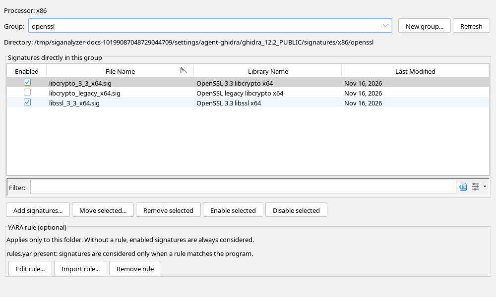
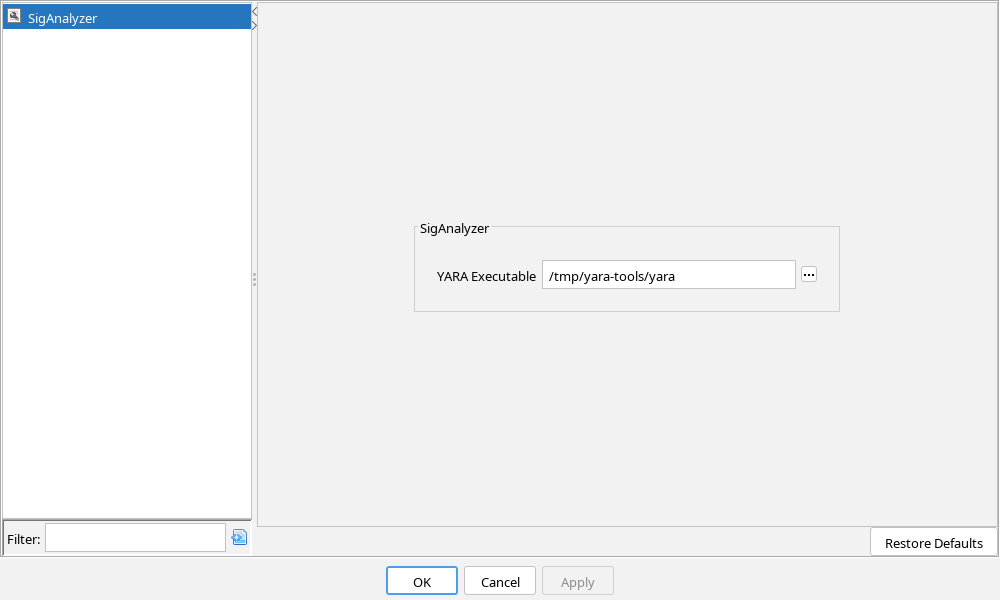

[日本語版README](README_ja.md)
# SigAnalyzer
A Ghidra extension that identifies existing functions with IDA FLIRT signatures,
preserves Function ID results, and records signature provenance. It supports
directory groups with optional YARA conditions and manual conflict resolution.

## Installation

Use **Ghidra 12.2** with **JDK 25**. Download the extension ZIP from
[Releases](https://github.com/blend-tea/SigAnalyzer/releases), install it using
**File → Install Extensions** in the Ghidra project window, and restart Ghidra.
Enable **SigAnalyzerPlugin** in the CodeBrowser's plugin configuration if its menu
is not visible. Extension archives are specific to the Ghidra version they were built against.

SigAnalyzer is added to the Analyzer.

A menu is added under **Tools** where you can add/remove signatures and choose which files to exclude from the Analyzer.

## Usage

### Supported signature formats

SigAnalyzer reads FLIRT `.sig` versions **5–11**, including IDA 9.5's v11
format, with uncompressed or zlib-compressed data. Version 11 uses a different
header, length-prefixed names and additional instruction/reference metadata;
changing a signature's version byte does not convert its format.
Zstandard-compressed signatures are currently unsupported and are reported in
the analysis log. Decompressed signatures and matching buffers are limited to 64 MiB.

### Adding FLIRT Signatures


Select **Tools → SigAnalyzer → Open SigAnalyzer**.



Choose **(default)** or create a directory with **New group...**, then use
**Add signatures...**. Select existing rows and use **Move selected...** to put
them in another group. The Enabled column and bulk buttons control which files
are considered during analysis.

## Added FLIRT Signatures
A new `signatures` folder is created under GhidraUserSettingsDir. Directories are created per processor name, and `.sig` files are copied there. Excluded files are listed in `config.json`.

## One Shot Analyze
You may need to run **Demangler Microsoft** or **Demangler Rust** as needed. With normal Auto Analyze, SigAnalyzer runs before the Demangler, so this is usually not required.

The analyzer applies names to existing functions and preserves program entry
points and user-defined names. Choose signatures for the program's processor,
platform and ABI. Mandatory referenced-function constraints must be resolved
before a module can match. Version 11's ordinary relocation sites are optional
evidence; tiny-module and import-name sites require a resolved target. SigAnalyzer
does not discover or create missing functions, or reproduce IDA's full scoring
and name-propagation behavior. See the [format review](docs/FLIRT_REVIEW.md) for limits.

## Function ID and ambiguous matches

SigAnalyzer runs after **Function ID** and before demanglers. Functions marked
by Function ID are excluded, including FID conflicts and matches for which
FID's analysis bookmarks were disabled. Identification uses FID bookmarks,
plate comments and conflict labels, rather than treating every analysis name
as a Function ID result.

All enabled FLIRT signatures are checked before a name is applied. When a
function has multiple distinct candidate names, its current name and comment
are retained. The **FLIRT Conflicts** window opens after analysis and lists the
address, current name, candidate name, signature file and library. Double-click
a row or press Enter to navigate to the function. Reopen the latest report with
**Tools → SigAnalyzer → FLIRT Conflicts**. The report is kept for the current
Ghidra session and is replaced when analysis completes again.

Right-click a candidate and choose **Apply FLIRT Candidate** to apply that
specific name. This explicit choice uses a user-defined name and retains the
selected name's signature provenance. It supports Ghidra Undo/Redo. Function ID
results, imported names and entry points remain protected. Finish running
analysis before applying a choice.


Several signatures that agree on the same name do not create a conflict.
Unique matches get a function-entry plate comment with a **SigAnalyzer FLIRT**
block listing the name and signature/library provenance. Existing comments are
preserved, and running the analyzer again updates the block without duplicating it.
Unresolved or ambiguous callee names cannot establish a referenced-function match.

## Signature groups and optional YARA rules

The signature manager groups `.sig` files by directory under the current
processor's signature folder. Select a group, create one with **New group...**,
add signatures, or use **Move selected...** to reorganize existing files.
Existing signatures in the processor folder remain in **(default)**. Moving a
signature preserves its enabled state; nested group names are supported.

Each group can have an optional **rules.yar**, created with **Edit rule...** or
loaded with **Import rule...**. A group with this file is analyzed only when at
least one rule matches the original imported binary stored by Ghidra. The rule
applies to `.sig` files directly in that directory; it does not apply to child
directories. A group without a rule is analyzed normally. **Remove rule** makes
the selected group ungated again. Changes invalidate old conflict reports;
run SigAnalyzer again to update the results.


```text
signatures/x86/
  legacy.sig                 # (default), no YARA gate
  openssl/
    rules.yar                # only controls openssl/crypto.sig
    crypto.sig
    other/
      extra.sig              # separate group, no inherited gate
```

Example `rules.yar`:

```yara
rule openssl_binary {
    strings:
        $marker = "OpenSSL" ascii
    condition:
        $marker
}
```

YARA gating requires a native **YARA 4** executable. Install `yara` (for example,
`apt install yara` on Debian/Ubuntu or `brew install yara` on macOS), or configure
the executable in the CodeBrowser's **Edit → Tool Options → SigAnalyzer → YARA
Executable**. Use the file chooser to select the native executable, then apply
the options. On Windows, select the downloaded YARA `.exe`. Enter a single
executable path without command-line arguments. Save the tool with **File → Save
Tool** to retain the setting in its configuration. Changes take effect on the
next SigAnalyzer run; no restart is required.
If the SigAnalyzer category is missing, enable **SigAnalyzerPlugin** in the
CodeBrowser's plugin configuration.



The configured tool path takes priority for programs analyzed in that tool.
If it is unset, SigAnalyzer retains the program's previous **YARA Executable**
analysis setting; its default is `yara`, resolved through PATH. Headless analysis
uses that existing analysis setting because no GUI tool is available.
**YARA Timeout Seconds** remains in the analysis options and defaults to 30 per
group. Groups without rules do not require YARA.

The gate uses original `FileBytes`, even when the original file is no longer
on disk; patched program memory is not the scan target. If several imports are
stored, the executable filename is preferred, then the program name, then the
first stored import. Relative YARA includes can refer to files in the group
directory. A missing engine, invalid rule, timeout or unavailable original bytes
skips the affected group and writes an analysis-log message. Other groups still run.

## Build and test

Install JDK 25 and extract the official
[Ghidra 12.2 distribution](https://github.com/NationalSecurityAgency/ghidra/releases/tag/Ghidra_12.2_build).
The Gradle wrapper downloads the pinned Gradle version and verifies its checksum.

```sh
export JAVA_HOME=/path/to/jdk-25
export PATH="$JAVA_HOME/bin:$PATH"
export GHIDRA_INSTALL_DIR=/path/to/ghidra_12.2_PUBLIC
./gradlew --no-daemon clean test buildExtension
src/test/run-headless.sh
```

The installable extension is written to `dist/`; JUnit results are in
`build/reports/tests/test/`. The headless test temporarily installs the built ZIP
and restores any existing SigAnalyzer extension afterwards.
The headless regression suite requires native `yara` on PATH, or its executable
path in `SIGANALYZER_TEST_YARA`, to exercise the optional YARA integration.
See [the FLIRT implementation review](docs/FLIRT_REVIEW.md)
for format references and regression coverage.

## CI and releases

GitHub Actions tests and packages the extension on pushes and pull requests.
It downloads the pinned Ghidra distribution and verifies its SHA-256 checksum.
To release, update `version` in `gradle.properties`, commit the changes, and push
a matching `vX.Y.Z` tag. After the build and tests pass, the workflow publishes a
GitHub Release with the extension ZIP. The release job uses the repository's
`GITHUB_TOKEN` with `contents: write` permission.
