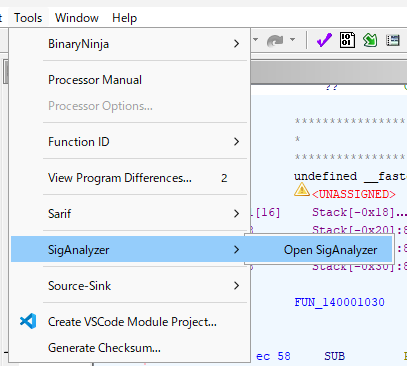
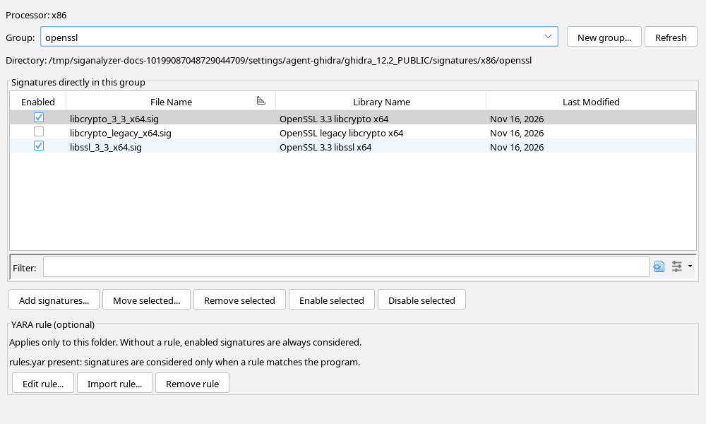
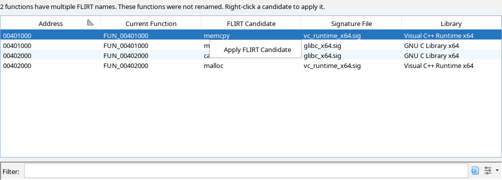
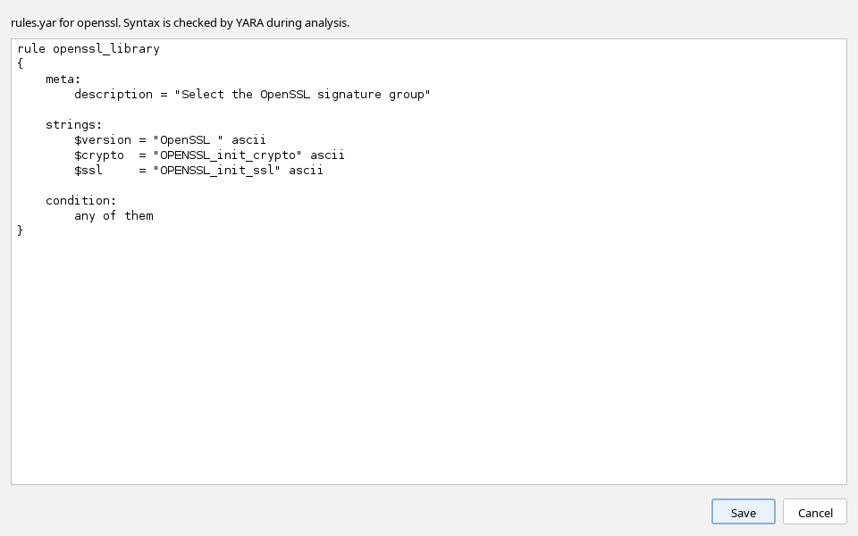
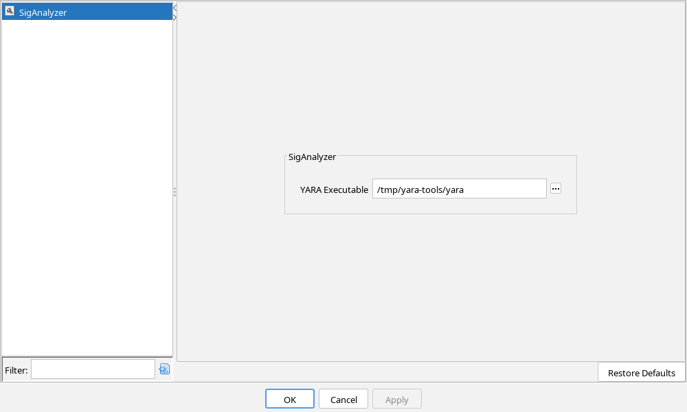

# SigAnalyzer
IDA FLIRT シグネチャで Ghidra の既存関数を識別し、名前と署名の出典を記録する拡張です。
Function ID の結果を保持し、ディレクトリごとの YARA 条件と、複数候補の手動適用に対応します。

## インストール

**Ghidra 12.2 / JDK 25** に対応しています。
[Releases](https://github.com/blend-tea/SigAnalyzer/releases) から拡張 ZIP を取得し、
Ghidra のプロジェクト画面で **File → Install Extensions** からインストールして再起動してください。
メニューが表示されない場合は CodeBrowser のプラグイン設定で **SigAnalyzerPlugin** を有効にします。
拡張 ZIP はビルド対象の Ghidra バージョン専用です。

解析器に SigAnalyzer が追加されます。

Tools のメニューから署名の追加・削除・グループ分けと、解析対象ファイルの選択ができます。

## 使い方

### 対応する署名形式

FLIRT `.sig` の **バージョン 5～11** に対応し、IDA 9.5 の v11 形式も読み込めます。
非圧縮・zlib 圧縮に対応しています。v11 ではヘッダー、長さ付きの関数名、命令・参照情報の形式が変わっているため、
バージョンの数値だけを書き換えても形式を変換できません。
Zstandard 圧縮は現在未対応で、解析ログに理由を表示します。
展開後の署名と照合用バッファーの上限はそれぞれ 64 MiB です。

### FLIRTシグネチャの追加



Tools -> SigAnalyzer -> Open SigAnalyzer を選択する。



**(default)** を選ぶか **New group...** でディレクトリを作成し、**Add signatures...** から署名を追加します。
登録済みの署名を選んで **Move selected...** から別グループへ移動できます。
Enabled 列と一括切り替えボタンで、解析対象にするファイルを選択します。

## 追加したFLIRTシグネチャ
GhidraUserSettingsDirに新しくsignaturesが生成され、processorNameごとのDirectoryが生成され、ここに.sigファイルがコピーされる。
config.jsonに除外対象のファイルが記述される。

## One Shot Analyze
必要に応じてDemangler MicrosoftやDemangler Rustを実行する必要がある。
通常のAuto AnalyzeではDemanglerの前にSigAnalyzerが動くようになっているので不要。

既存の関数に名前を適用し、プログラムのエントリーポイントとユーザー定義の名前を保持します。
対象のプロセッサ・プラットフォーム・ABI に合うシグネチャを選んでください。
必須の参照先条件を確認できないモジュールは適用を保留します。
v11 の通常の relocation site は補助情報として扱い、短いモジュールとインポート名の site は参照先の一致を必須にします。
未定義関数の作成や、IDA のスコアリング・名前の伝播処理全体を再現する機能はありません。
対応範囲の詳細は [実装レビュー](docs/FLIRT_REVIEW.md) を参照してください。

## Function ID との共存・複数候補

SigAnalyzer は **Function ID の後、Demangler の前**に実行します。
Function ID の識別結果がある関数は FLIRT の対象から除外します。
FID の複数候補も保護し、FID の解析ブックマークを無効にした場合も関数先頭のコメントから判定します。
ブックマーク・コメント・FID の競合ラベルで識別するため、他の解析器が付けた名前まで一律に除外しません。

有効な署名すべての候補を収集してから名前を適用します。
同じ関数に異なる候補名がある場合は、現在の名前とコメントを保持します。
解析終了後に **FLIRT Conflicts** ウィンドウを開き、アドレス・現在の関数名・候補名・署名ファイル・ライブラリを一覧表示します。
行のダブルクリックまたは Enter で対象関数へ移動できます。
**Tools → SigAnalyzer → FLIRT Conflicts** から再表示でき、結果は Ghidra の現在のセッション内で保持します。
再解析の完了時に一覧を更新します。

候補の行を右クリックして **Apply FLIRT Candidate** を選ぶと、その名前を適用します。
明示的に選んだ名前はユーザー定義名として保持し、選択した名前の署名情報をコメントに記録します。
Ghidra の Undo/Redo に対応します。FID の結果・インポート名・エントリーポイントは引き続き保護します。
解析が実行中の場合は、終了してから適用してください。



複数の署名が同じ名前を示す場合は競合として扱いません。
一意に識別した関数の先頭には、名前・署名ファイル・ライブラリを記録した **SigAnalyzer FLIRT** コメントを追加します。
既存のコメントを保持し、再実行時は専用ブロックを更新して重複を防ぎます。
未解決または複数候補の呼び出し先を、参照先一致の根拠には使用しません。

## 署名グループと任意の YARA ルール

署名管理画面でディレクトリごとのグループを選択できます。
**New group...** で作成し、署名を追加するか **Move selected...** で登録済みの署名を移動します。
従来のプロセッサフォルダー直下の署名は **(default)** グループとして使えます。
移動時に有効／無効の状態を保持し、入れ子のグループ名にも対応します。

各グループに **rules.yar** を任意で作成できます。
**Edit rule...** で編集するか **Import rule...** で取り込みます。
ルールがあるグループは、Ghidra が保存している元バイナリに少なくとも 1 つのルールが一致した場合だけ解析します。
対象は同じディレクトリ直下の `.sig` のみで、子ディレクトリには継承しません。
ルールがないグループは通常どおり解析し、**Remove rule** で条件を解除できます。
設定変更時は古い Conflict 一覧を無効化するため、SigAnalyzer を再実行してください。



```text
signatures/x86/
  legacy.sig                 # (default): 条件なし
  openssl/
    rules.yar                # openssl/crypto.sig だけの条件
    crypto.sig
    other/
      extra.sig              # 別グループ: 親の条件は継承しない
```

`rules.yar` の例:

```yara
rule openssl_binary {
    strings:
        $marker = "OpenSSL" ascii
    condition:
        $marker
}
```

YARA 条件を使うグループには、ネイティブの **YARA 4** 実行ファイルが必要です。
Debian/Ubuntu では `apt install yara`、macOS では `brew install yara` などで導入します。
Windows などで実行ファイルを直接指定する場合は、CodeBrowser の
**Edit → Tool Options → SigAnalyzer → YARA Executable**
から、ファイル選択で実行ファイルを指定して設定を適用します。
Windows ではダウンロードした YARA の `.exe` を選択してください。コマンド引数は含めません。
**File → Save Tool** でツールの設定として保存できます。変更は次回の SigAnalyzer 実行から反映され、再起動は不要です。
SigAnalyzer の項目がない場合は、CodeBrowser のプラグイン設定で **SigAnalyzerPlugin** を有効にしてください。



このツールで解析するプログラムには、Tool Options のパスを優先して使用します。
未設定の場合は従来の解析オプション **YARA Executable** にフォールバックします。
その初期値は `yara` で、PATH から検索します。
GUI ツールのない headless 解析では、従来の解析オプションを使用します。
**YARA Timeout Seconds** の初期値はグループごとに 30 秒です。
タイムアウトは引き続き解析オプションで設定します。
ルールがないグループでは YARA の導入は不要です。

照合には Ghidra が保持する元の `FileBytes` を使用するため、元ファイルがディスク上になくても動作します。
パッチ後のプログラムメモリは照合しません。複数のインポートがある場合は、実行ファイル名、プログラム名、最初のインポートの順で選択します。
相対パスの YARA include はグループディレクトリ内のファイルを参照できます。
エンジン不在・構文エラー・タイムアウト・元バイト不在の場合は、そのグループだけを除外して解析ログに理由を表示します。

## ビルドとテスト

JDK 25 をインストールし、公式の
[Ghidra 12.2 配布物](https://github.com/NationalSecurityAgency/ghidra/releases/tag/Ghidra_12.2_build)
を展開してください。Gradle Wrapper が指定バージョンの Gradle を取得し、チェックサムを検証します。

```sh
export JAVA_HOME=/path/to/jdk-25
export PATH="$JAVA_HOME/bin:$PATH"
export GHIDRA_INSTALL_DIR=/path/to/ghidra_12.2_PUBLIC
./gradlew --no-daemon clean test buildExtension
src/test/run-headless.sh
```

インストール用 ZIP は `dist/`、JUnit の結果は `build/reports/tests/test/` に生成されます。
headless テストは生成した ZIP を一時導入し、既存の SigAnalyzer 拡張があれば終了時に復元します。
YARA 連携も検証するため、headless テストには PATH 上の `yara`、または環境変数 `SIGANALYZER_TEST_YARA` に実行ファイルのパスを設定する必要があります。
FLIRT の比較対象と回帰テストの詳細は [実装レビュー](docs/FLIRT_REVIEW.md) を参照してください。

## CI / Release

GitHub Actions で push・pull request 時にテストと拡張のビルドを実行します。
Ghidra の配布物はバージョンを固定し、SHA-256 を確認して使用します。
リリース時は `gradle.properties` の `version` を更新してコミットし、対応する `vX.Y.Z` タグを push します。
ビルドとテストに成功すると、拡張 ZIP を添付した GitHub Release が作成されます。
公開ジョブには `contents: write` を付与したリポジトリの `GITHUB_TOKEN` を使用します。
